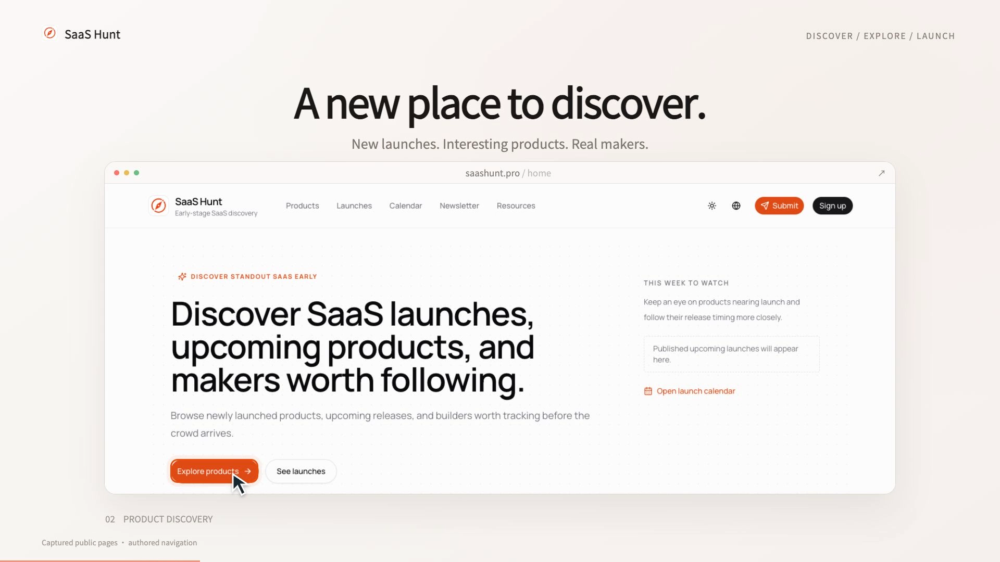

# SaaS Hunt / 30-second product film

This example demonstrates public product discovery at https://saashunt.pro/: homepage, catalog, AI category, a product detail page, and a return to discovery. All page images were captured from the public site on 2026-10-10. The video uses authored navigation and original editorial motion, not a recorded authenticated session.

## Watch

[](video.mp4)

[Play or download the film](video.mp4) · [Storyboard](storyboard.png) · [Soundtrack](soundtrack.wav) · [Review report](review.md)

## Reproduce

From the repository root:

```sh
python3 scripts/example.py ../saas-hunt-promotion
cd ../saas-hunt-promotion
npm ci
# Optional: specify the actual local Chrome executable.
export PROMOTION_BROWSER="/Applications/Google Chrome.app/Contents/MacOS/Google Chrome"
npm run studio
npm run render
npm run check
npm run check-cues
npm run motion-report
```

The initialized project includes editable source, configuration, font, and local page assets. Rendering does not request SaaS Hunt or an image-generation service.

## Story

| Time | Message | Product evidence |
|---|---|---|
| 0–3s | Discover standout SaaS early | Brand and homepage positioning |
| 3–7s | A new place to discover | Captured homepage and Explore products entry |
| 7–12s | Explore the catalog | Captured public product directory |
| 12–17s | Find your category | Captured AI category and a selected product |
| 17–23s | Look closer | Captured hairforge detail and maker information |
| 23–27s | Discover your next tool | Captured catalog rows in an editorial card arrangement |
| 27–30s | Your next discovery starts here | Brand and site address |

Card expansion, cropping, cursor placement, and transitions are presentation choreography. They do not claim the website performs the same animation. No like, bookmark, follow, sign-in, or submission was executed. The page's visible counters are captured values, not marketing proof of popularity.

## Sound

Original sample-free procedural electro groove and operation accents, authored at 120 BPM. Shared frame events drive focus and SFX. Important cues land on the authored beat grid; event-shaped ducking makes room for them. The score is included under MIT. The optional external CC0 track is not used in this film.

## Rights and evidence

Source URLs, timestamps, hashes, and capture preparation are in [sources.json](public/sources.json). Product imagery and trademarks retain their owners' rights; they are excluded from the repository's original-code MIT grant. [Review evidence](review.md) separates machine checks, visual inspection, and any remaining listening limitations.
